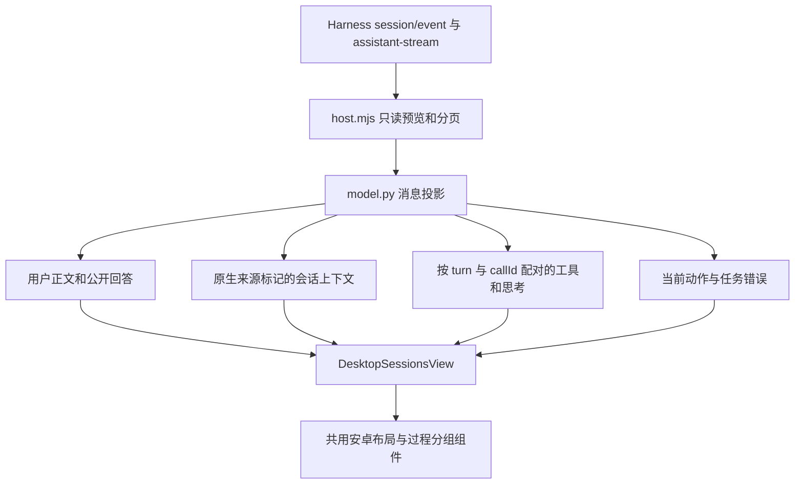

# DeepSeek Harness 手机聊天体验

本次将个人版 Codex 的安卓紧凑布局、执行详情分组与当前动作展示接入 DeepSeek Harness。随个人发行版 **v2.1.18** 提供 Mac arm64 / x64 和 Android 包，手机构建号 51。

## 页面行为

- 安卓标题栏、可滑动工具栏与输入行共用宿主适配。只有“聊天”时不额外显示标签栏；工作台按钮仍打开文件、Git、终端选择器。重复初始化不重复包裹控件，原草稿、附件和操作事件保留。
- 使用 Harness 原生 `user/message.data.source.kind` 区分用户正文和自动上下文。`runtime-context`、`agent-instructions` 等非用户来源进入默认折叠的“会话上下文”；用户粘贴的同名标签和普通英文不靠文本内容过滤。原生记录不修改。
- 连续工具记录和思考按原生 `turn` 分组，默认折叠；调用与结果按 `turn + callId` 配对，结果不重复计数。分页只有结果时保留“部分历史”，加载调用所在页后合并原参数与输出。
- 公开回复与任务级错误保持独立可见；工具异常在分组摘要中显示数量。隐藏过程时仍保留异常证据。展开状态在轮询及历史前插时保持。
- 当前动作复用 `ChatActivityStatus`，显示原生动作及可确认的开始时间，最多五行。只有 `running` 且已连接时显示；完成、断线、返回列表及账号切换后清除。



## 原生流式预览

以本机 Harness Desktop **0.2.2-rc.3** 的包内类型及实现为证据，接入 `agent/assistant-stream`、`session/event` 和 Agent 生命周期事件。不调用 `follow`、不激活被动读取的会话，不启动第二份运行时。

预览验证 Agent 身份、会话、attempt、递增 revision 与 chunk index。缺帧、无效块、abandoned、Agent 退出或新轮次出现时丢弃临时预览；每个会话的文本最多 256 KiB、128 个块，总计最多 32 个会话。只投影公开文本与原生思考，不返回提供商重放状态、用量或临时工具参数。

临时内容具有稳定 ID。提交后只保留至当前分页 `asOfSeq` 追上原生 assistant 记录，避免正文重复。旧历史页不携带实时预览。分页 I/O 完成后再次读取当前 Agent 的运行状态，避免旧列表的 `idle` 清掉刚开始生成的回复。持久化记录进入下一步时也清除过期预览。

没有对应事件的旧版本仍能读取已持久化历史，不能据此声称有逐字实时输出。手机页面按有界轮询读取预览，并非为每个 token 建立公网连接。

## 详情连接恢复

详情读失败保留正文和草稿，并暂停依赖实时状态的操作；已有正文连续失败三次后显示重试提示。首开或手动重试失败立即反馈。只读请求合并，后台暂停，返回前台及网络恢复时刷新一次；失败按 1、3、8、15、30 秒退避。

临时桌面不可达使用 HTTP 503；明确不可重试的原生拒绝使用 409，登录和权限仍遵守原校验。成功读取仅清除自己的连接错误，不清除发送或审批错误。

发送、停止和审批不进入自动重试。持久化操作 ID、写入结果未知及不自动重放规则保留。连接诊断只记录接口类型、耗时、HTTP 状态、错误类型和前后台状态，不记录消息正文、凭据或原始错误响应。

## 升级与修改入口

插件协议 revision 从 **7 升至 8**，来源校验继续接受已发布 revision 7 的 LF/CRLF 哈希。旧接入保留凭据、目录、操作回执及配置，加载新插件仍需按原任务保护流程重启接入；仅刷新手机网页不能更新电脑已加载的插件。

共享页面变化通常无需重装 Android APK。预览包采用独立名称、应用 ID 和数据目录，正式版不自动切换到预览。不要同时让两份网关写入同一套原生客户端或回执。

| 内容 | 入口 |
| --- | --- |
| 来源、工具、当前动作投影 | `bridge/clients/deepseek/model.py`、`adapter.py` |
| 原生实时预览与版本 | `bridge/clients/deepseek/host.mjs`、`setup.py` |
| 共享分组及动作组件 | `web/features/chat/timeline.js` |
| 聊天与详情恢复 | `web/features/clients/desktop-sessions.js` |
| 安卓宿主适配 | `web/hosts/android-presentation.js/.css` |

## 验证

```sh
python3 -B scripts/test-backend.py --source-only
npm run test:desktop
node scripts/smoke-reading-ui.cjs
./node_modules/.bin/electron scripts/smoke-deepseek-ui.cjs
```

DSH 浏览器夹具在 320/390/844/1440 px、深浅主题下运行生产页面，所有会话和调用均为合成数据。截图和结果保存在 `.tmp/deepseek-experience/`。覆盖紧凑布局、原控件身份、草稿、工作台、上下文完整性、思考分组、20 次工具调用、公开回复、工具与任务异常、当前动作及结束清理。

纯 Python/Node、浏览器夹具和本地包启动分别记录，不能代替 Android 真机的键盘、后台恢复、推送与真实模型工具执行验收。

### 2026-11-14 本地验收结果

| 范围 | 结果 |
| --- | --- |
| Python 完整源码回归 | 执行 2741 项，无失败，82 项按平台或原生环境跳过 |
| Node 完整回归 | 1289 项通过，1 项按环境跳过 |
| Codex 阅读、进度和当前动作浏览器回归 | browser/Android、五种宽度、中英文共 20 个场景通过 |
| DSH 页面浏览器回归 | 8 个尺寸/主题场景，208 项断言通过；包含宿主适配晚加载 |
| 本地 Mac arm64 包 | 独立预览 App 与冻结网关启动、认证、签名、99 个页面源文件及 7 个 HTTP 资源比对通过 |
| 包内页面回归 | 使用实际包内资源重复执行 DSH 的 208 项断言通过 |

源码阶段先使用独立 `2.1.18-preview.deepseek.1` Mac arm64 包验证冻结运行时和页面资源。正式交付使用主仓库提交构建 `2.1.18`，沿用既有应用标识、签名、网关数据目录和手机绑定；安装前保留旧 App 备份。

升级电脑网关后，在 Harness 原生任务与审批全部结束时，使用“重启并接入”加载 revision 8，然后刷新手机页面。版本号、实际进程和加载的插件 revision 需要分别核对，安装新 App 并不表示旧进程已经加载新代码。Android 键盘、网络切换、后台恢复与真实模型工具执行由手机用户验收。
